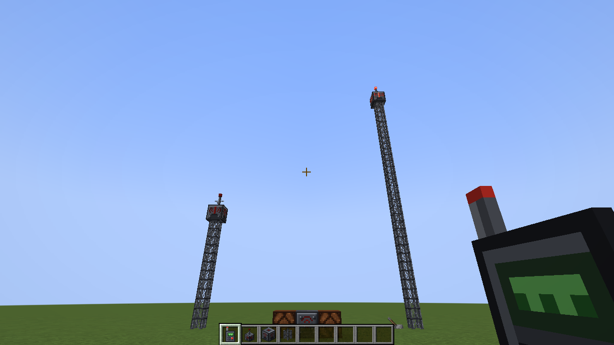
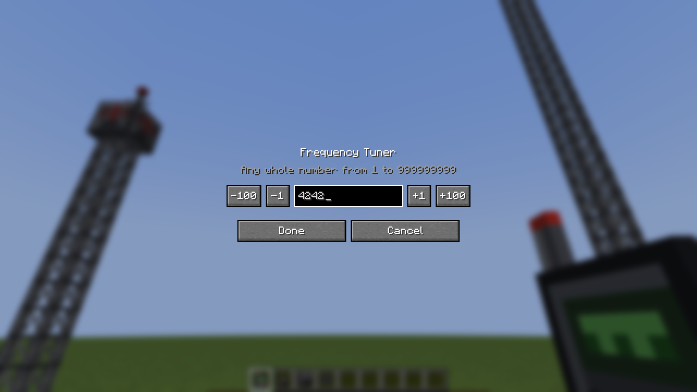
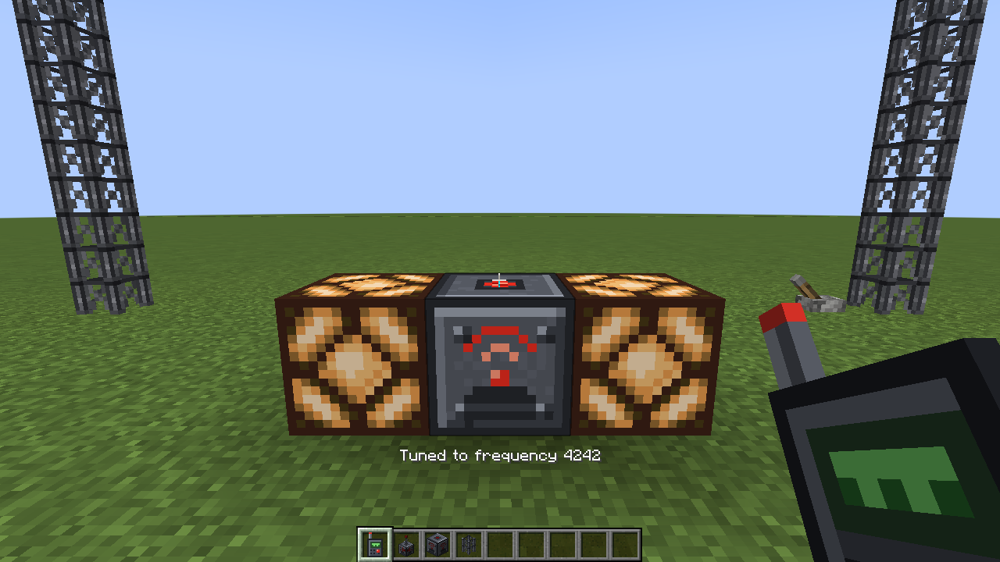

# Reiko's Redstone Signal Tower

A Minecraft **1.21.1 NeoForge** mod that adds radio towers for redstone. Put a transmitter high up on a tower and it sends your redstone signal to receivers far away. The higher the tower, the farther it reaches.



## Blocks and items

| | What it does |
|---|---|
| **Radio Transmitter** | Broadcasts the redstone signal it receives (strength 0–15) on its frequency. The higher above sea level it sits, the farther it reaches. Its warning light glows while it's broadcasting. |
| **Radio Receiver** | Outputs the strongest signal it hears on its frequency, at the same strength. Works like a redstone block with a dimmer. |
| **Radio Mast** | Lattice tower segment for building your tower. A mast column also carries redstone **up**: power any mast in the column and the transmitter on top broadcasts it. |
| **Frequency Tuner** | Sets which frequency a transmitter or receiver uses. |

## How to use it

1. **Build a tower.** Stack Radio Masts and put a Radio Transmitter on top.
2. **Power it from the ground.** Put a lever, redstone wire, or any other signal next to any mast in the column, or next to the transmitter itself.
3. **Tune it.** Right-click the air with a Frequency Tuner and type a frequency (any whole number from 1 to 999,999,999). Then right-click the transmitter with the tuner.

   

4. **Set up the far end.** Put a Radio Receiver where you want the signal and right-click it with the same tuner. It outputs whatever the transmitter is sending.



**Tuner controls:**
- Right-click the air: type a new frequency.
- Right-click a transmitter or receiver: tune it to the tuner's frequency.
- Sneak + right-click a transmitter or receiver: copy its frequency into the tuner.

**Other details:**
- Right-click a transmitter or receiver with an empty hand to see its frequency, signal, height and reach.
- Breaking a transmitter or receiver keeps its frequency on the dropped item, so you can move it without re-tuning.
- One transmitter can feed any number of receivers. A receiver that hears several transmitters on its frequency outputs the strongest.
- A transmitter keeps broadcasting its last signal while its chunk is unloaded, so long-distance links keep working.
- Don't put a receiver next to a transmitter (or its mast column) on the **same** frequency. That makes a loop that latches on, like a redstone torch loop.

### Reach

Reach is measured horizontally from the transmitter, so a receiver works at any height inside that circle.

```
reach = 32 + 8 × (blocks above sea level)
```

| Transmitter at | Height above sea level | Reach |
|---|---|---|
| Y=63 or lower (Overworld) | 0 | 32 blocks |
| Y=80 | 17 | 168 blocks |
| Y=100 | 37 | 328 blocks |
| Y=150 | 87 | 728 blocks |
| Y=319 (build limit) | 256 | 2,080 blocks |

Sea level is the dimension's own: Y=63 in the Overworld, Y=32 in the Nether, Y=−63 in a default superflat world. Building on a mountain counts too.

All three numbers (base reach, reach per block of height, and an optional maximum) are in the server config: `<world>/serverconfig/reikos_signal_tower-server.toml`, or Mods → Reiko's Redstone Signal Tower → Config.

### Recipes

```
Radio Transmitter       Radio Receiver          Radio Mast (x6)       Frequency Tuner
  .  L  .                 .  L  .                 B  .  B               .  T  .
  I  E  I                 I  E  I                 B  I  B               I  G  I
  I  T  I                 I  P  I                 B  .  B               I  R  I

L = Lightning Rod   E = Ender Pearl   T = Redstone Torch   P = Redstone Repeater
I = Iron Ingot      B = Iron Bars     G = Glass Pane       R = Redstone Dust
```

## Building and running

You need **Java 21**. If Gradle can't find it, it downloads one automatically.

```bash
./gradlew build              # builds build/libs/reikos_signal_tower-<version>.jar
./gradlew runClient          # starts Minecraft with the mod
./gradlew runServer          # starts a dedicated server with the mod
./gradlew runGameTestServer  # runs the automated in-game tests, then exits
```

On Windows use `gradlew.bat` instead of `./gradlew`.

**IntelliJ IDEA:** File → Open → pick this folder's `build.gradle` → Open as Project. Wait for the Gradle sync to finish, then use the generated run configurations (Client, Server, GameTestServer).

To play it in your own instance, copy the jar from `build/libs/` into the instance's `mods` folder. Every push to `main` is also built by GitHub Actions. The jar is attached to each run under **Actions → Build → Artifacts**.

## Project layout

```
src/main/java/com/reiko/signaltower/
  SignalTower.java                       mod entry point: registration, creative tabs, packets
  Config.java                            server config (reach settings)
  registry/ModRegistry.java              blocks, items, block entities, the frequency data component
  block/RadioBlock.java                  shared transmitter/receiver code: status readout, tooltips
  block/RadioTransmitterBlock.java       reads input, broadcasts
  block/RadioReceiverBlock.java          redstone output
  block/RadioMastBlock.java              tower segment, carries signal up to the transmitter
  blockentity/RadioBlockEntity.java      stores the frequency, keeps it through break/re-place
  blockentity/RadioTransmitterBlockEntity.java
  blockentity/RadioReceiverBlockEntity.java
  item/FrequencyTunerItem.java           tune, copy, open the tuner screen
  network/SetTunerFrequencyPayload.java  tuner screen -> server packet
  radio/SignalNetwork.java               per-dimension list of transmitters, saved with the world
  radio/RadioHelper.java                 height, reach, mast-column logic
  radio/Frequency.java                   frequency range (1 to 999,999,999)
  client/TunerScreen.java                the frequency entry screen
  client/ClientHooks.java, SignalTowerClient.java   client-only setup
  gametest/SignalTowerGameTests.java     automated tests
src/main/resources/
  assets/reikos_signal_tower/            blockstates, models, textures, en_us.json
  data/reikos_signal_tower/              recipes, loot tables, recipe-book unlocks, test structure
tools/
  make_textures.py                       draws all textures (needs Pillow)
  make_data.py                           writes models, blockstates, lang, recipes, loot tables
docs/
  DESIGN.md                              how it works under the hood, ideas for later
```

The `tools/` scripts are how the textures and JSON files were generated. You can keep using them, or paint and edit the files directly. Re-running a script overwrites what it writes.

## Automated tests

`./gradlew runGameTestServer` boots a server and checks that:

1. a signal crosses the gap, turns off with the input, and stops when the transmitter is broken;
2. signal strength is kept (14 in, 14 out);
3. different frequencies don't hear each other, and re-tuning a receiver links it;
4. a receiver just out of reach goes live once the transmitter is raised 4 blocks on masts;
5. masts carry the signal up from any point in the column, and a gap in the column cuts it;
6. the tuner tunes a block on right-click and copies a block's frequency on sneak + right-click;
7. a broken transmitter drops an item that keeps its frequency.

## License

All rights reserved. To open-source it, add a `LICENSE` file and update `mod_license` in `gradle.properties`.
