# Reiko's Redstone Signal Tower

A Minecraft **1.21.1 NeoForge** mod that adds radio towers for redstone. Put a transmitter high up on a tower and it sends your redstone signal to receivers far away. The higher the tower, the farther it reaches.


## Blocks and items

| | What it does |
|---|---|
| **Radio Transmitter** | Broadcasts the redstone signal it receives (strength 0–15) on its frequency. The higher above sea level it sits, the farther it reaches. Its warning light glows while it's broadcasting. It also relays Remote Control presses made within reach of it. |
| **Radio Receiver** | Outputs the strongest signal it hears on its frequency, at the same strength. Works like a redstone block with a dimmer. |
| **Radio Repeater** | A relay station. It picks up its frequency where it stands and broadcasts it again, at the same strength, with its own reach. Put repeaters on towers along the way to send a signal much farther than one transmitter can. Needs no redstone. Its amber light glows while it's repeating. |
| **Radio Converter** | A repeater that changes the frequency. It picks up one frequency and broadcasts it on another, so one switch can drive receivers on a second frequency, or two networks can be joined. Its teal light glows while it's converting. |
| **Radio Toggle Receiver** | A receiver that works like a light switch: each time its frequency turns on, it flips between off and on (full strength). A pulse remote, a button or a pressure plate then switches things on with one press and off with the next. |
| **Compact Radio Receiver** | A button-sized receiver. Sticks to walls, floors and ceilings like a button, and like a button it also powers the block it's stuck to, so it can drive redstone on the other side of a wall. Pops off (keeping its frequency) if that block is removed. |
| **Code Keypad** | A keypad for a wall, floor or ceiling. Type the right code and it sends a pulse on its frequency, and powers the block it's on, so it opens a door right next to it too. Only its owner sets the code, and three wrong codes in a row lock the typer out and alert the owner. |
| **Radio Mast** | Lattice tower segment for building your tower. A mast column also carries redstone **up**: power any mast in the column and the transmitter on top broadcasts it. |
| **Frequency Tuner** | Sets which frequency a transmitter or receiver uses. Keeps 5 favorite frequencies, and sneak + scroll changes its frequency without opening a screen. Its screen can also name a frequency, or make it private to you and your friends, and its **Directory** button lists every named and private frequency in the world. Hold it and look at a tower to see a ring on the ground where its reach ends. |
| **Remote Control** | A handheld transmitter, like a garage door opener. Press it to send a signal on its frequency: a 1-second pulse like a button, or toggle on/off. Has the same scrolling and favorites as the tuner. |
| **Multi-Button Remote** | A remote with 4 buttons, each with its own frequency, mode, name and color. One remote can run your door, lights and farm. |
| **Radio Pager** | A pocket receiver. Keep it anywhere in your inventory and it beeps and shows a message when its frequency turns on near you. |
| **Signal Scanner** | A handheld direction-finder. It lists every frequency you can hear where you stand, how strong it is and where it comes from, and can tune the radio item in your other hand. |
| **Wall Redstone** | Redstone dust that sticks to the side of a block. It runs up, down and sideways along a wall, loses 1 strength per block like normal dust, connects to normal dust and redstone components, and powers the block it's on. |

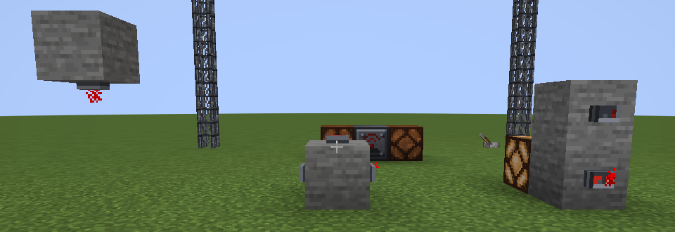

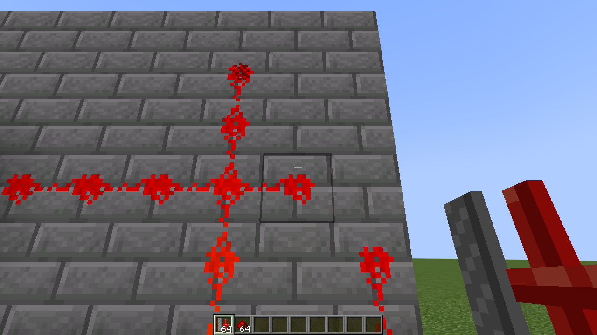

## How to use it

1. **Build a tower.** Stack Radio Masts and put a Radio Transmitter on top.
2. **Power it from the ground.** Put a lever, redstone wire, or any other signal next to any mast in the column, or next to the transmitter itself.
3. **Tune it.** Right-click the air with a Frequency Tuner and type a frequency (any whole number from 1 to 999,999,999). Then right-click the transmitter with the tuner.

   

4. **Set up the far end.** Put a Radio Receiver where you want the signal and right-click it with the same tuner. It outputs whatever the transmitter is sending.


**Tuner controls:**
- Right-click the air: type a new frequency.
- Right-click a transmitter or receiver: tune it to the tuner's frequency.
- Sneak + right-click a transmitter or receiver: copy its frequency into the tuner.
- Sneak + scroll: step the tuner's frequency up or down by 1. The new number shows above your hotbar, and your hotbar slot doesn't move.
- Sneak + Ctrl + scroll: jump to the next favorite (scroll down) or the previous one (scroll up).
- **Favorites:** the tuner's screen has 5 favorite slots under the frequency.
  - Click an empty slot to save the frequency above it.
  - Click a saved one to put its frequency in the box.
  - Sneak-click a saved one to replace it with the frequency above.
  - Right-click a saved one to clear it.

  Favorites are saved straight away (even if you then press Cancel), stay on the tuner, and are listed in its tooltip. The slot matching the frequency in the box shows in green.

  The Remote Control and Radio Pager have the same scrolling and favorites, each with its own 5 slots. The Multi-Button Remote keeps sneak + scroll for picking its button.

  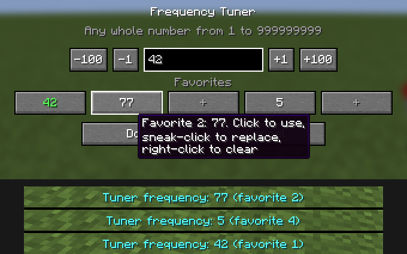

**Frequency names:**
- **Naming one:** give a frequency a name in the Frequency Tuner's screen. Type the frequency, type a name in the **Name** box under it (up to 24 characters), and press Done: "Frequency 2026 is now called Front Gate, for everyone". The box shows the typed frequency's current name; clear it and press Done to remove the name.
- **Shared:** names belong to the world. Everyone on a server sees the same names, they're saved with the world, and they count in every dimension. Anyone holding a tuner can rename a frequency, except a private one (only its owner and their friends can).
- **Where they show:** most places a frequency number appears, as "2026 (Front Gate)":
  - item tooltips (tuner, remotes, pager, radio blocks);
  - the remote's press message and the pager's alerts, chat log and catch-up lines;
  - the tuner's "Tuned to" message and the empty-hand readouts;
  - the scanner's rows ("Front Gate: Repeater, 7 blocks east") and its tracking arrow;
  - Jade, and the converter screen.

  The Remote Control and pager screens show the typed frequency's name under the title.
- **Unnamed frequencies:** they show just their number, as before. A world holds up to 4,096 names.

  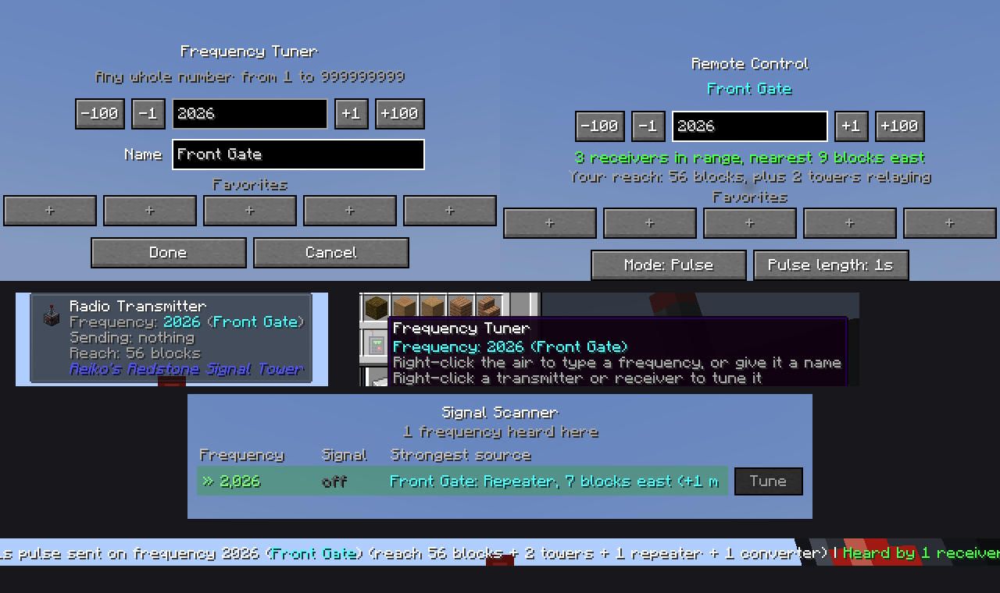

**Frequency notes:**
- **Adding one:** in the Frequency Tuner's screen, type the frequency and click **Note** (next to the Name box). Type a short note on what it's for, like "lever by the front door; also lights the hall" (up to 64 characters), and press **Save** or Enter: "Note for frequency 2026 (Front Gate) saved". Clear the box and save to remove it. The Note button turns yellow when the typed frequency has a note, and hovering it shows the note.
- **Shared:** like names, notes belong to the world: everyone on a server sees them, they're saved with the world, and they count in every dimension. Anyone holding a tuner can change one, except on a private frequency (only its owner, their friends and server operators can; others see it read-only).
- **Members only:** on a private frequency, the Note screen's **Who sees it** button switches between Everyone and **Members only**; press Save: "Note for frequency 2026 (Front Gate) saved, for members only". Then only the owner, their friends, members of groups the frequency uses and server operators get the note. Everyone else's game never receives it, so it's missing from their directory, Jade and tooltips. Members see it marked "(members only)", and the tuner's Note button tooltip says "Note (members only): …".
  - Adding or taking off friends or group members gives them the note or takes it away at once.
  - Making the frequency public makes the note everyone's again for good (the tuner warns "Done makes it public again, and its note visible to everyone"); claiming it later doesn't hide it again.
  - On a public frequency the button is greyed out: only a private frequency's note can be kept to its members.
- **Where they show**, in grey italics:
  - the frequency directory: after the name in the Name column, in the row's tooltip, and the search box matches notes too ("hall" finds 2026);
  - Jade, under the frequency line (a converter shows both its frequencies' notes);
  - item tooltips: the tuner, Remote Control, pager, radio blocks, the converter (both frequencies) and the Multi-Button Remote's selected button.
- A frequency with only a note (no name, public) is listed in the directory too. A world holds up to 4,096 notes.

  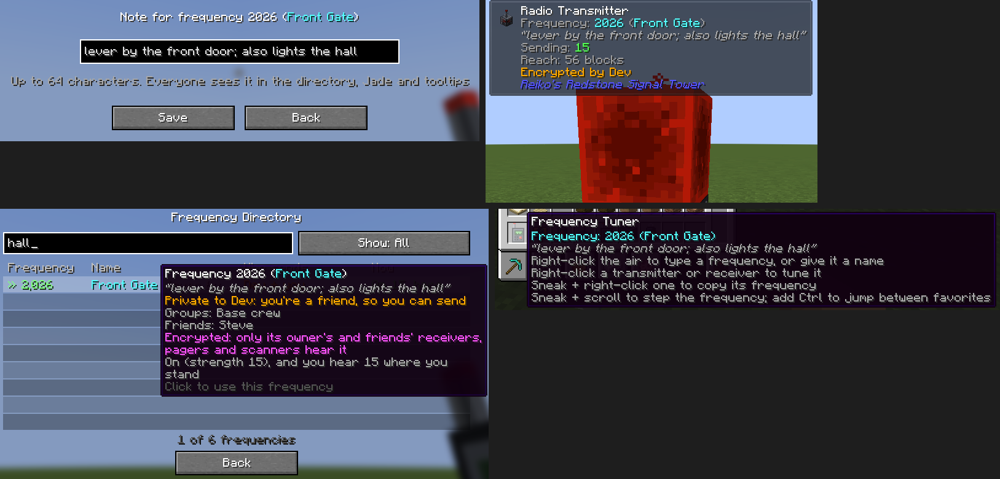

  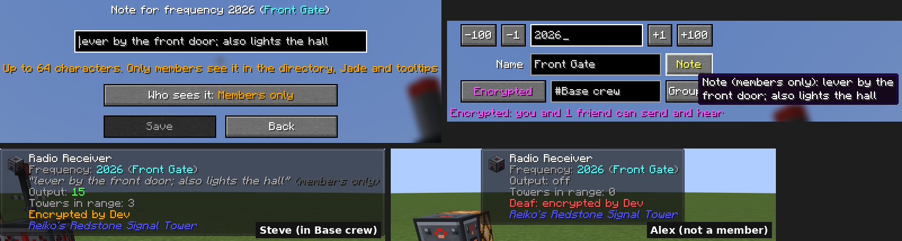

**Private frequencies:**
- **Making one private:** in the Frequency Tuner's screen, type the frequency and click the button under the Name box so it says **Private** instead of **Public**, then press Done: "2026 (Front Gate) is now private: only you can send on it". The line under the button says who can send on the typed frequency, or what Done will change.
- **Friends:** type players' names in the box next to the button, separated by commas (up to 16), and press Done: "only you and Steve can send on it". A friend must be online the first time you add them; after that they stay a friend by their account, online or not. Delete a name and press Done to take them off.
- **What private means:** only you and your friends can send on it.
  - Other players' remote presses are refused, with a red light: "Can't send: 2026 (Front Gate) is private to Dev".
  - Transmitters, repeaters and converters only broadcast on it if you or a friend tuned or placed them (each block remembers who last tuned or placed it). Anyone else trying to tune one onto it is refused: "Can't do that: it would send on 2026 (Front Gate), which is private to Dev". One they place with that frequency already on it stays silent: "Silent: 2026 (Front Gate) is private to Dev, so this won't broadcast".
  - Taking a friend off silences their blocks on it at once; adding them back brings them back.
  - Only you and your friends can rename it.
- **Listening stays open:** anyone's receivers, toggle receivers, pagers and scanners still hear it, and anyone can tune a receiver to it. To close that too, encrypt it (below).
- **Claiming fairly:** you can't make a frequency private while other players' transmitters, repeaters or converters send on it ("other players' blocks already send on it"). Pick one nobody else uses.
- **Older blocks:** blocks tuned before version 0.25 don't know who tuned them, so they keep working on a private frequency. Tune one again to make it yours.
- **Who can change it:** only the owner can change the friends or make it public again (click the button until it says **Public**, then Done). Server operators can make anyone's private frequency public the same way. Other players see the button greyed out: "Private to Dev: you can't send on it".
- **Friend groups:** click **Groups** next to the Friends box to manage your own named lists of players, like "Base crew".
  - In the Groups screen, click **+ New group**, type a name and its members (separated by commas), and press **Save**: "Group Base crew created with 1 member". Pick a group on the left to change it; **Delete** (click twice) removes it.
  - Use a group on a frequency by typing `#Base crew` in the Friends box (on its own, or with single names: `#Base crew, Alex`), or click **Use here** in the Groups screen to add it to the frequency in the tuner. Done: "only you and #Base crew can send on it".
  - Changing a group changes every frequency using it at once: add someone and they can send on all of them; take them out and their blocks on all of them go silent. The Groups screen shows which frequencies use the selected group ("Used by: 2026 (Front Gate), 4242 (Vault)"). Renaming a group keeps it on those frequencies; deleting it takes its members off them.
  - Members must be online the first time you add them, like friends. Up to 16 groups per player, 32 members per group, and 4 groups per frequency.
- **Encrypted frequencies:** click the button once more so it says **Encrypted** (it goes Public, Private, Encrypted; sneak-click goes back) and press Done: "2026 (Front Gate) is now encrypted: only you and #Base crew can send on it or hear it". An encrypted frequency is private, and listening is closed too:
  - Only receivers, toggle receivers and converters that you or a friend (or a member of a group it uses) tuned or placed hear it. Anyone else's stay off. Jade shows "Deaf: encrypted by Dev" on them, and tuning or placing one says "Deaf: 2026 (Front Gate) is encrypted by Dev, so this won't hear it".
  - Only pagers and scanners carried by you or a friend hear it. Anyone else's pager stays quiet (its tooltip says "Encrypted by Dev: this pager can't hear it") and reports nothing about it after logging in. Their scanner doesn't list it, can't track its towers, and stops tracking one once the frequency is encrypted.
  - In anyone else's directory it just says "Encrypted", even standing next to its tower.
  - Remotes' "Heard by" counts and locator lines only count receivers and pagers that can hear it.
  - Adding a friend (or a group member) lets their receivers hear it at once; taking them off makes them deaf again. A toggle receiver doesn't count becoming able to hear (or deaf) as a turn-on.
  - Changing it back to **Private** opens listening again, without changing who can send.
  - Old blocks tuned before version 0.25 (no recorded tuner) still hear it, like they can still send. Tune one again to make it yours.
- **Limits:** up to 32 private frequencies per player (`privateFrequenciesPerPlayer` in the server config; 0 turns the feature off), and 4,096 per world.
- **Jade** shows "Private to Dev" (or "Encrypted by Dev") on a private frequency's blocks, "Silent: private to Dev" on ones kept quiet, and "Deaf: encrypted by Dev" on receivers and converters that can't hear. The empty-hand readout and the converter's screen also say when a block is kept quiet.

  

  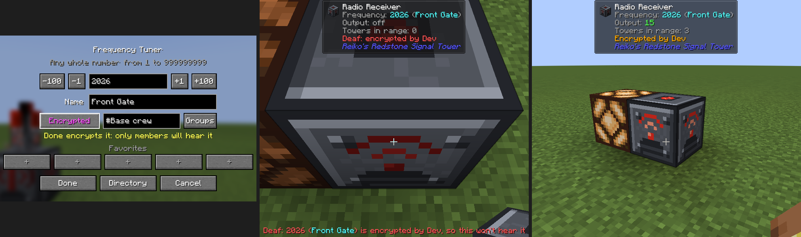

  

**Frequency directory:**
- **Opening it:** click **Directory** in the Frequency Tuner's, Remote Control's or Radio Pager's screen (between Done and Cancel). The Multi-Button Remote's keypad has a small **...** button after each button's frequency, and the Radio Converter's screen one after each of its two boxes (that works with nothing in your hand). It lists every named and private frequency in the world, in order.
- **Columns:**
  - **Frequency** and **Name**. The one typed in the screen you came from is marked "»".
  - **Who sends:** "Anyone" for a public frequency; "You" or "You + 2" (friends) for your own private one; "Dev + you" for one where you're a friend; "Dev" (red) for someone else's.
  - **Now:** "On 15" if something is sending on it anywhere in your dimension, "On 15, here" if you also hear it where you stand, "Off" if nothing is.
- **Others' private frequencies stay private:** for someone else's private frequency the directory only says "Here 15" when you can hear it where you stand, and "?" otherwise, so it can't be used to watch their base from afar. Someone else's encrypted frequency only says "Encrypted".
- **Using one:** click a row and it goes into the screen you came from (with its name and privacy, in the tuner's; into that button's or that box's frequency in the keypad and the converter's screen), so you just press Done. **Back** returns with what you'd typed.
- **Finding one:** type in the search box to match a name, a note, a number or an owner. The **Show** button switches between All, Named, Private, Mine (private ones you own or are a friend on) and On now; sneak-click goes back. Hover a row for details: who owns it, its friends (if you're one of them), and whether it's on.
- It updates every second while open.
- **Auditing one of yours:** sneak-click one of your own private frequencies (an operator: anyone's) to list every block on it, in every dimension: transmitters, repeaters and converters sending on it, converters listening on it, and receivers (only while their chunk is loaded).
  - Each row says what it is, where it is, who tuned or placed it, and its status: "On 15" or "Off" when it works, **Silent** for a sender whose tuner can't send on it, **Deaf** for a listener whose tuner can't hear it (encrypted). Hover a row for the distance and direction and what the status means. The line under the list sums it up ("10 blocks: 1 silent, 1 deaf, 5 with no recorded tuner").
  - Your blocks and your friends' show their position. So do old blocks with **no record** of who tuned them (set up before version 0.25): they still work on a private frequency, so the audit helps you find them; tuning one again with the Frequency Tuner makes it yours.
  - Other players' blocks are only counted ("Receiver ×2, Alex, Deaf"), without positions, so the audit can't be used to find someone's base.
  - **Finding one:** click a row that shows a position to put a gold beam of light over that block for a minute ("Beam on: Repeater at 535, −60, −15, for a minute. Close to see it"). The row gets a gold edge and its tooltip counts down; click it again to turn the beam off. Press **Close** (next to Back) to close every screen and look around. You can have up to 8 beams on at once.
    - Only your own game draws the beams, so nobody else sees them.
    - They show from far away, even past your render distance's fog where the block itself isn't drawn. Far beams are drawn wider so they stay easy to spot.
    - A beam in another dimension shows when you're there. Beams go away when you leave the world.
  - **Handing it over:** the owner's audit has a **Hand over...** button. It lists the frequency's friends and group members; click the one who should own it, then **Hand over** twice. Both of you get a chat message ("4242 (Vault) now belongs to Steve. You stay on it as their friend" and "Dev handed 4242 (Vault) over to you: it's yours now").
    - Everyone else on it, you included, stays on it as a friend, so no block goes silent. It keeps its name, note and encryption.
    - Groups belong to their owner, so their members become single friends of the new owner.
    - It's refused if the new owner already has the most private frequencies a player may have, or if it has more members than a frequency's 16 friends (take some off first). Only the owner can hand it over; operators can't.
  - **Its log:** the audit's **Log** button (for the owner and server operators) lists the frequency's last turn-ons, newest first, from every dimension. Each row says when (in-game day and time), what turned it on (a **Transmitter**, a **Remote pulse** or a **Remote toggle**) and who (who tuned the transmitter, or whose remote).
    - A transmitter that's yours, a friend's or has no record shows where it is; click its row for a beam of light over it, as in the audit. Another player's transmitter is named but not located, and where someone pressed a remote is never kept.
    - Hover a row for how long ago it was ("47 seconds ago"). A turn-on carried over from another frequency by a converter says so ("Transmitter on 2026").
    - Each dimension keeps the last 32 turn-ons of each frequency (the same ones the pager catch-up uses). Ones from before version 0.35 show as "Turned on", without a cause.
  - **Guest passes:** the owner's audit has a **Guests...** button. Type a player's name (they must be online), then pick **1 hour**, **1 day** or **1 week**: "Alex is a guest on 2026 (Front Gate) for 1 hour". Until the pass runs out they can send on it like a friend (and hear it, if it's encrypted), and they're told in chat.
    - The list shows each guest's time left ("59 minutes left"). Click one, then pick a time to renew their pass, or **Remove** to end it now.
    - Passes run on real time, so they keep counting while the server is off. When one runs out, the guest drops off, their blocks go silent (or deaf) again, and both of you are told if you're online.
    - Up to 8 guests per frequency. Friends and group members don't need a pass. Editing the friends or handing the frequency over keeps the guests. In the audit and the log, a guest's blocks show like a friend's.
  - **Intruder alerts:** when someone who isn't on one of your private frequencies tries to use it, you're told in chat: "Radio alert: Alex pressed a remote on 2026 (Front Gate), but it's private: refused". It covers a refused remote press, a transmitter, repeater or converter they tried to tune onto it, a block they placed on it that stays silent, and one they set to it that can't hear it (encrypted). Since version 0.37 it also covers three wrong codes in a row on one of your Code Keypads, on any frequency (see **Code Keypad** below).
    - Like the audit, an alert never says where their block is. (A keypad alert says where your keypad is.)
    - The same player, frequency and kind of try alerts at most once a minute.
    - If you're offline, you get them when you log in: "While you were away, someone tried your private frequencies or keypads (3 times):", then the last five with their in-game day and time.

  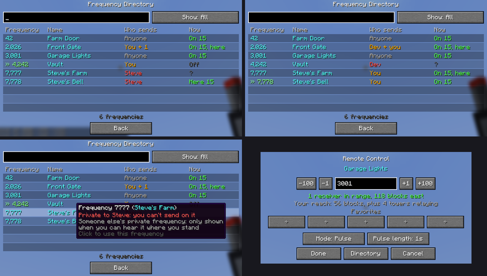

  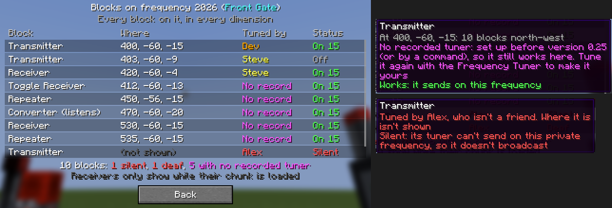

  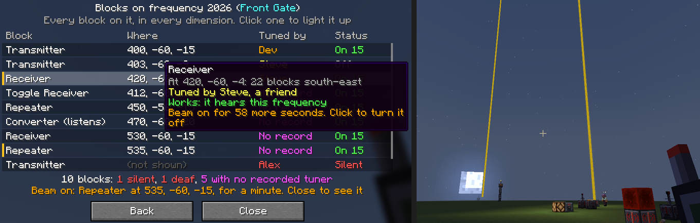

  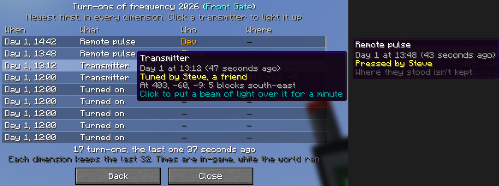

  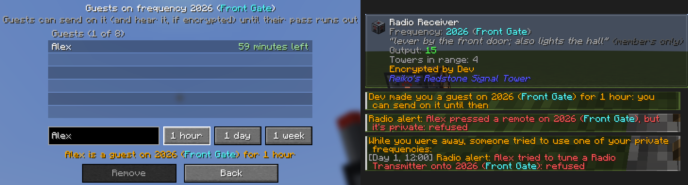

  

  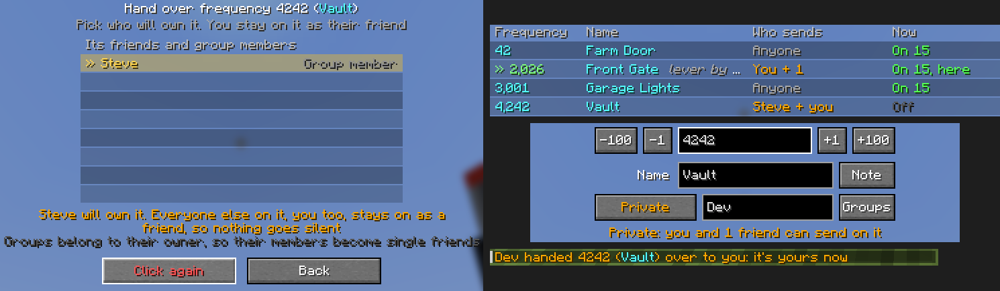

  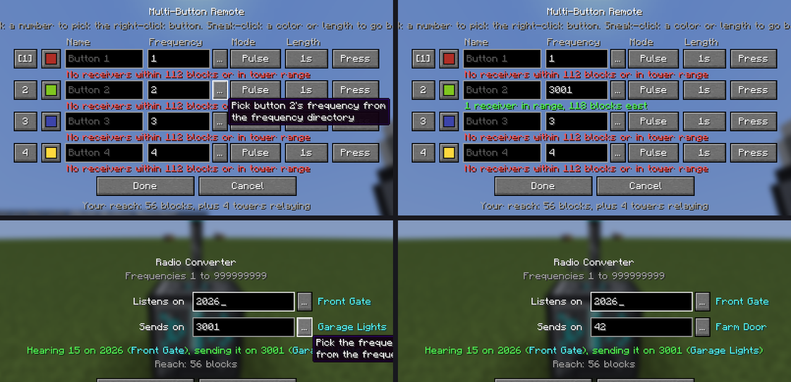

**Remote Control:**
- Right-click: press the button.
- Sneak + right-click the air: change its frequency, switch between **Pulse** and **Toggle** (on until you press it again), and set the **pulse length**. Click the length button for longer or sneak-click for shorter: 0.1s, 0.25s, 0.5s, 1s (the default, like a stone button), 1.5s, 2s, 3s, 5s or 10s.
- Sneak + right-click a transmitter or receiver: copy its frequency.
- Sneak + scroll, Sneak + Ctrl + scroll and the 5 favorites in its screen work just like the tuner's (see **Tuner controls** above). Scrolling doesn't change its mode or pulse length.

  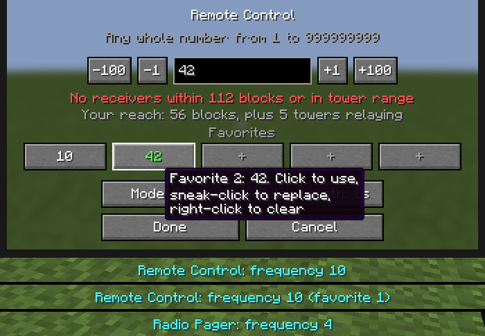
- Its reach uses the same height rule as a transmitter, measured from where you're standing, so pressing it from a hilltop or the top of a tower reaches farther.
- **Tower relay:** every Radio Transmitter (and Radio Repeater) within your remote's reach relays your press. The signal goes out again from the top of that tower, with the tower's reach. So you can stand at the foot of a tall tower, press, and reach as far as the tower does. It works on any frequency (the tower doesn't need to be on the remote's frequency, or powered), so one tall tower at your base boosts every button. The message shows how many towers relayed it ("reach 56 blocks + 1 tower"), and the signal light and "Heard by" count include them. A toggle switched on through a tower goes off if that tower is broken. Server owners can turn relaying off in the config (`towersRelayRemotes`).

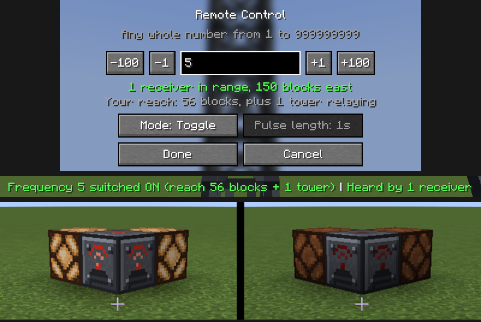
- Any remote on the same frequency can switch a toggle off, so a lost remote can't leave something stuck on.
- **Signal light:** after each press, the light on the remote shows **green** for 2 seconds if at least one receiver on that frequency was in range, or **red** if none was. The message also says how many receivers heard it. This works on both remotes.

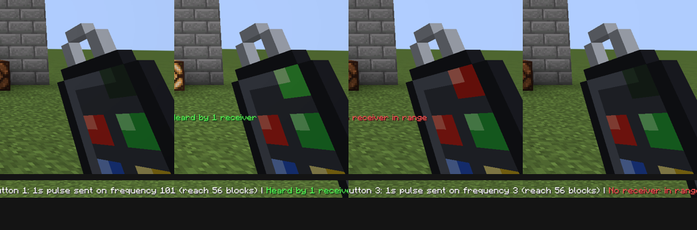

- **Locator:** while a remote's screen is open, each frequency shows who's listening, without sending anything. For example "2 receivers in range, nearest 14 blocks north-east", or "None in range. Nearest is 120 blocks south". A line underneath shows your reach and how many towers are relaying for you ("Your reach: 56 blocks, plus 1 tower relaying"). It updates about once a second, follows what you type, and only sees receivers in loaded chunks: within twice your own reach, or anywhere a relaying tower (or a repeater on that frequency) carries your press.

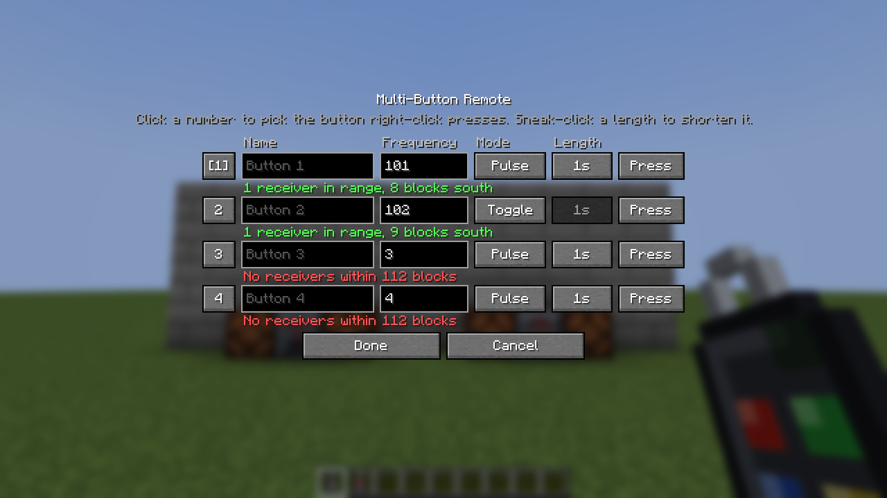

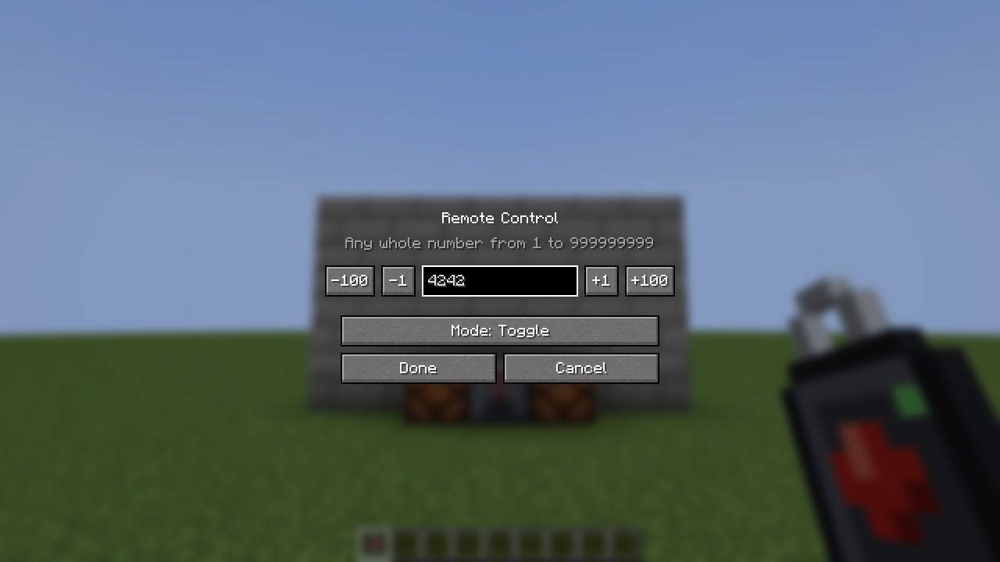

**Multi-Button Remote:**
- Right-click: press the **selected** button.
- Sneak + scroll: choose the selected button. Your hotbar slot doesn't move.
- Sneak + right-click the air: open the keypad. From there you can press any button, give each button a **name** (like "Front Door") and a **color**, set its frequency, Pulse/Toggle mode and pulse length, and click a button's number to make it the selected one.
- **Button colors:** click a button's color square in the keypad for the next of the 16 dye colors, or sneak-click for the previous one. The four buttons on the remote itself (in your hand, hotbar and inventory) change to match, and each button's name shows in its color in the tooltip and press messages. New remotes, and remotes made before this version, start red, green, blue and yellow.
- Names show up everywhere: the tooltip, the press message ("Front Door: 1s pulse sent…") and the selection message ("Farm Lights selected…"). Unnamed buttons show as "Button 1" to "Button 4". Names can be up to 24 characters.
- Sneak + right-click a transmitter or receiver: copy its frequency into the selected button.
- The tooltip lists all 4 buttons, with the selected one marked ».

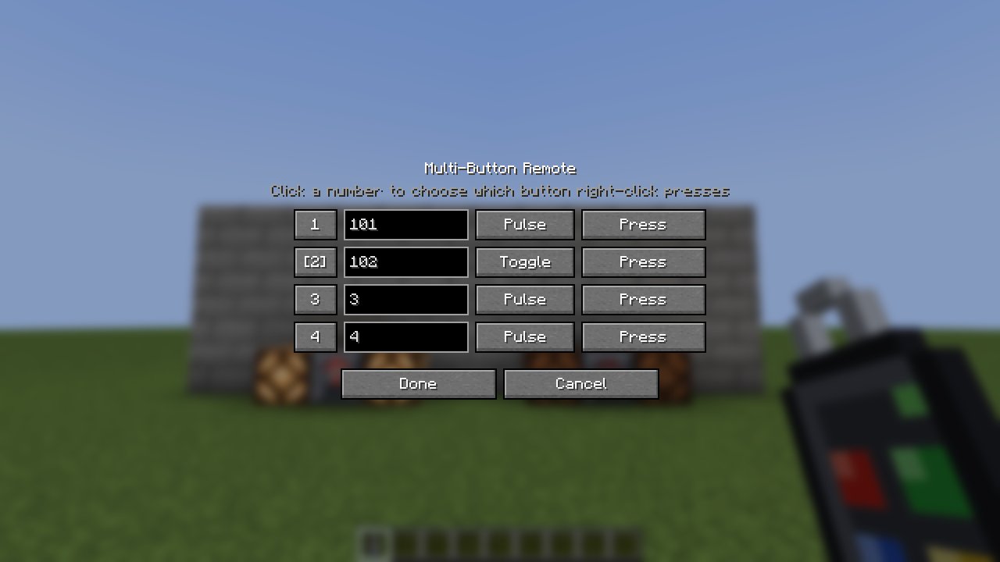

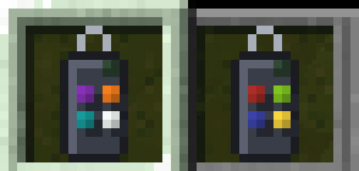

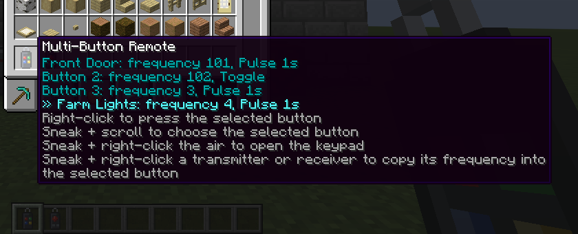

**Radio Pager:**
- Keep it anywhere in your inventory (hotbar, backpack slots or off-hand). When its frequency turns on where you are, it beeps three times and shows "Radio Pager: frequency 5 is ON (strength 15)". "Where you are" means inside the reach of a transmitter or repeater on that frequency, or of a remote press (including towers relaying it).
- It alerts once each time the signal turns on, not again while it stays on. Its little screen glows green while the signal is on, and the tooltip shows the live status.
- Rename it in an anvil and the alert uses that name: "Front Door: frequency 5 is ON".
- **Chat log:** each alert also goes into chat, with the in-game day and time in front: "[Day 4, 08:30] Front Door: frequency 5 is ON (strength 15)". Open chat to scroll back and see what went off while you weren't looking. It's on for every pager by default; switch it off for one pager (say, one on a fast clock) with the **Chat log** button in its screen. The time comes from the world's clock, with each day starting at midnight.

  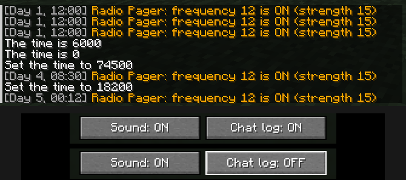
- **Catch-up (on servers):** when you log out, each pager in your inventory notes the time. When you log back in, each one that missed something tells you in chat: "Gate: while you were away, frequency 42 turned on 2 times, last on Day 1 at 18:34". It counts every time its frequency turned on where you're standing (a transmitter being powered, a remote press, a toggle switched on), even across server restarts. If none of your pagers missed anything, you get one line saying so. Each frequency remembers its last 32 turn-ons, so after a long time away it may say "at least 32 times". A singleplayer world is paused while you're out of it, so there's nothing to catch up on there and the pagers stay quiet.

  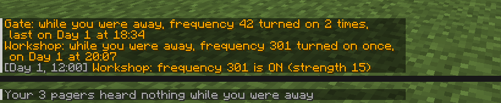
- Right-click: switch the sound on or off. With the sound off it still shows the message.
- Sneak + scroll, Sneak + Ctrl + scroll and the 5 favorites in its screen work just like the tuner's. After a change it alerts if the new frequency is already on.
- Sneak + right-click the air: change its frequency, and switch its **Sound** and **Chat log** on or off. Sneak + right-click a transmitter or receiver: copy its frequency.
- Pagers count toward a remote's "Heard by" number and signal light, so a doorbell press shows green when only your pager hears it. The locator never shows pagers, so it can't be used to find players.
- The beep is only heard by the pager's owner.

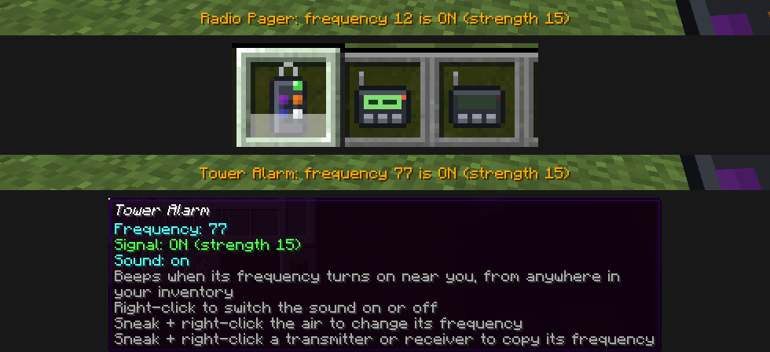

**Signal Scanner:**
- Right-click to open it. It shows a live list (updated every second) of everything a receiver where you're standing would hear: every frequency, its strength ("ON 15", or "off" for a transmitter that's silent right now), and its strongest source.
- For a transmitter, the source is its distance and direction: "Transmitter, 27 blocks south". If several transmitters on that frequency reach you, it points to the strongest one (the nearest, if they're equally strong) and says how many more there are ("+1 more").
- For a repeater it says "Repeater, 78 blocks west" in the same way, and a repeater with nothing to repeat is listed as "off". A converter is listed under the frequency it sends on ("Converter, 52 blocks west").
- For a remote press it just says "Remote pulse" or "Remote toggle", with no distance or direction, so it can't be used to find players.
- Strongest signals come first. Scroll the mouse wheel if there are more than 6.
- **Track with an arrow:** click a transmitter's (or repeater's) row to track it. While you hold the scanner (either hand), an arrow at the top of the screen points to that transmitter as you walk and turn, with the distance underneath and how far up or down it is: "Frequency 77: 3 blocks, 30 up". The tracked row shows in green with a "»". Click it again to stop. If the transmitter is broken or re-tuned to another frequency, the scanner says it lost track. With several transmitters on one frequency, it tracks the one the row points to. Remote presses can't be tracked, so it still never points at players.

  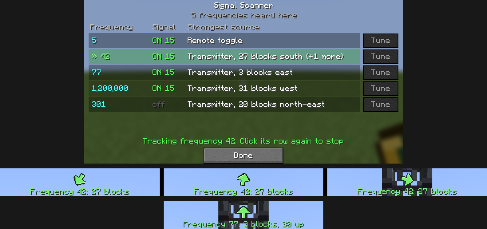
- **Tune:** hold a Frequency Tuner, Remote Control, Multi-Button Remote or Radio Pager in your other hand, and each row's Tune button sets that frequency on it. A remote keeps its mode and pulse length, and a Multi-Button Remote changes only its selected button.

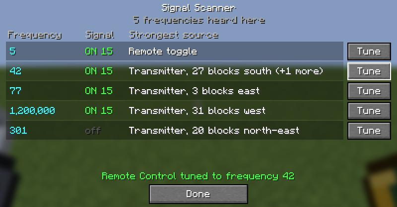

**Jade (optional):**
- If you have [Jade](https://modrinth.com/mod/jade) installed, just look at a block to see its details in Jade's info box, with no clicking:
  - **Radio Transmitter:** frequency, what it's sending ("Sending: 15" or "Sending: nothing") and its reach.
  - **Radio Repeater:** frequency, what it's repeating ("Repeating: 15" or "Nothing to repeat") and its reach.
  - **Radio Converter:** both frequencies ("Listens on: 2026", "Sends on: 3001"), what it's converting and its reach.
  - **Radio Receiver** and **Compact Radio Receiver:** frequency, output ("Output: 15" or "Output: off") and how many transmitters and repeaters reach it ("Towers in range: 2").
  - **Radio Toggle Receiver:** frequency, "Switched on" or "Switched off", what it's hearing right now, and towers in range.
  - **Radio Mast:** what's on top of its column and how far up ("Top: Radio Repeater, 3 blocks up"), and that tower's frequency. Handy at the foot of a tall tower.
  - On a private frequency, any of them also shows "Private to Dev", or "Silent: private to Dev" for a transmitter, repeater or converter kept quiet.
- Jade needs to be on the server too for the frequency, reach and tower count (they're only known there). With Jade only on your side, it still shows what the block itself shows: on or off, and a receiver's output.
- Switch it off in Jade's settings (numpad 0 → Plugin Settings → Reiko's Redstone Signal Tower).
- The mod doesn't need Jade. Without it, everything works the same, and an empty-hand right-click still shows the status readout.

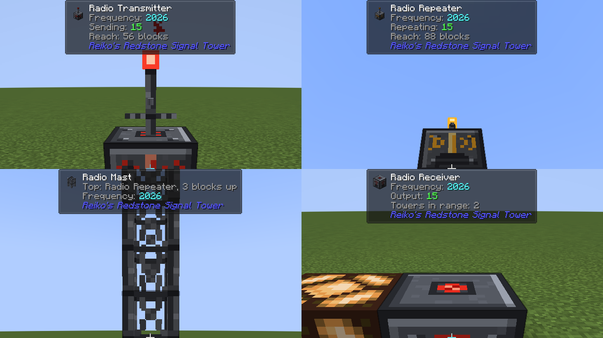

**Other details:**
- Both receivers are tuned with the Frequency Tuner and act the same; pick the full block or the compact one depending on how much room you have.
- Right-click a transmitter or receiver with an empty hand to see its frequency, signal, height and reach. A receiver's "Towers in range" counts the transmitters and repeaters on its frequency that reach it.
- Breaking a transmitter, receiver or repeater keeps its frequency on the dropped item, so you can move it without re-tuning.
- One transmitter can feed any number of receivers. A receiver that hears several transmitters on its frequency outputs the strongest.
- A transmitter keeps broadcasting its last signal while its chunk is unloaded, so long-distance links keep working.
- Don't put a receiver next to a transmitter (or its mast column) on the **same** frequency. That makes a loop that latches on, like a redstone torch loop.

### Toggle receivers

A **Radio Toggle Receiver** doesn't pass the signal through like a normal receiver. It **flips** each time its frequency turns on where it stands, like a T flip-flop: the first turn-on switches it on, the next one switches it off, and so on. Turning off does nothing.

- **What it outputs:** while it's on, it outputs full strength (15), whatever strength it heard, and its lights glow. It starts off.
- **What counts as a turn-on:** any time its frequency goes from silent to on. That includes a remote pulse, a button or pressure plate driving a transmitter, a lever, or a toggle remote being switched on.
- **Use it as a light switch:** with a pulse remote, one press turns your lights on and the next turns them off. Put buttons on transmitters at both ends of a hallway and either one switches the same lamps.
- **No surprise flips:** placing it, re-tuning it, or its chunk loading while the frequency is already on doesn't flip it. It waits for the next turn-on.
- **Saving:** its on/off state is saved with the world. Breaking it drops a toggle receiver that remembers its frequency, but starts off when placed again.
- **Unloaded chunks:** turn-ons while its chunk is unloaded are missed, because it only listens while loaded.
- **Readout and Jade:** an empty-hand right-click shows "Toggle Receiver | Frequency 2026 | ON | Hearing 15 | Towers in range: 2". Jade shows "Switched on" or "Switched off", and what it's hearing.
- **Counts as a receiver:** it counts toward a remote's "Heard by" and signal light, and the locator finds it like any receiver.

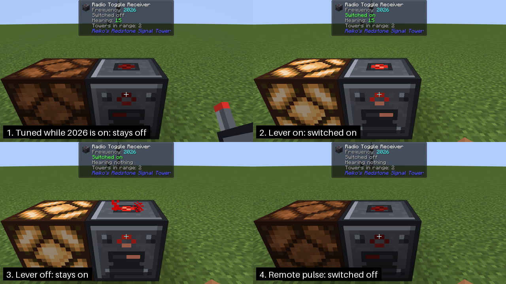

### Repeater towers

One transmitter only reaches so far. To go farther, put a **Radio Repeater** partway out, inside the transmitter's reach, and tune it to the same frequency. The repeater picks up the signal and broadcasts it again from where it stands, with its own reach. Receivers in either circle hear it.

- **Build it like a transmitter tower:** Radio Masts with the repeater on top. It uses the same height rule, so the higher it is, the farther it sends. It doesn't need redstone or power.
- **Chain them:** a repeater inside another repeater's reach passes the signal on again, so a line of towers can carry it across the map. The strength stays the same at every hop (15 in, 15 out at the far end).
- **No loops:** repeaters only pass on a signal that comes from a real transmitter or remote press somewhere up the chain. Two repeaters in each other's reach can't keep each other on: when the transmitter goes quiet, the whole chain goes quiet within a tick.
- **Remote presses too:** a remote press that reaches a repeater on its frequency is passed along the chain like anything else. The message counts those repeaters ("reach 56 blocks + 1 tower + 1 repeater"), and the "Heard by" count and signal light include the receivers they reach.
- **Relay tower:** like a transmitter, a repeater within your remote's reach also relays your presses on any frequency.
- It keeps repeating while its chunk is unloaded, like a transmitter.
- Right-click it with an empty hand: "Repeater | Frequency 2026 | Repeating 15 | 7 blocks above sea level | Reach 88 blocks", or "Nothing to repeat".
- The pager, the Signal Scanner ("Repeater, 78 blocks west"), the remote's locator and the pager catch-up all take repeaters into account.

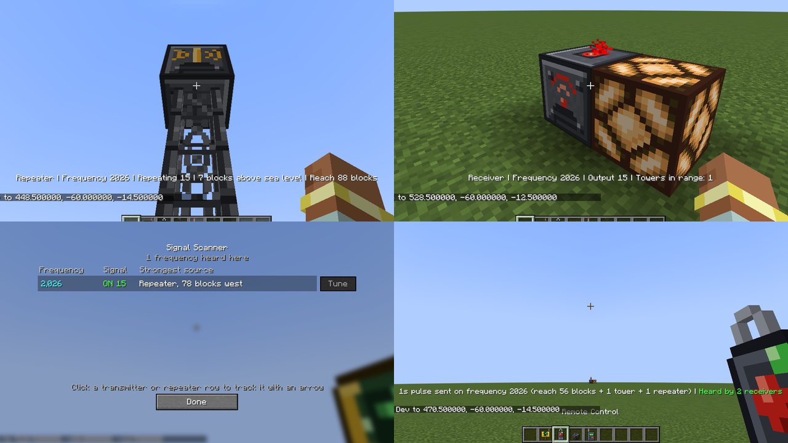

### Converters

A **Radio Converter** works like a repeater, but it sends on a **different** frequency than it listens on. It hears frequency 2026 where it stands, say, and broadcasts it on 3001, at the same strength, with its own reach. That lets one lever or remote button drive things on a second frequency too, or link two separate networks.

- **Setting it up:** right-click it with an empty hand to open its screen, with a **Listens on** box and a **Sends on** box (Tab moves between them, Enter saves). The screen also shows what it's converting right now and its reach. The Frequency Tuner sets (and copies) the frequency it listens on, like any radio block.
- **Height, chains and towers:** it follows the same rules as a repeater. Reach grows with height, it needs no redstone, and it chains with repeaters and other converters (a repeater listening on 3001 carries the converted signal further). Like other towers, it relays remote presses on any frequency.
- **No loops:** even two converters feeding each other (2026 to 3001 and 3001 back to 2026) go quiet as soon as the real source does.
- **Remote presses:** a press on 2026 that reaches the converter is carried over to 3001. The message counts it ("reach 56 blocks + 2 towers + 1 repeater + 1 converter"), and "Heard by" and the signal light include the receivers on 3001.
- **Everything else:** pagers on 3001 go off from it, the Signal Scanner lists it under the frequency it sends on ("Converter, 52 blocks west"), and the pager catch-up remembers turn-ons it carried. Jade shows both frequencies.
- Breaking it keeps both frequencies on the dropped item.

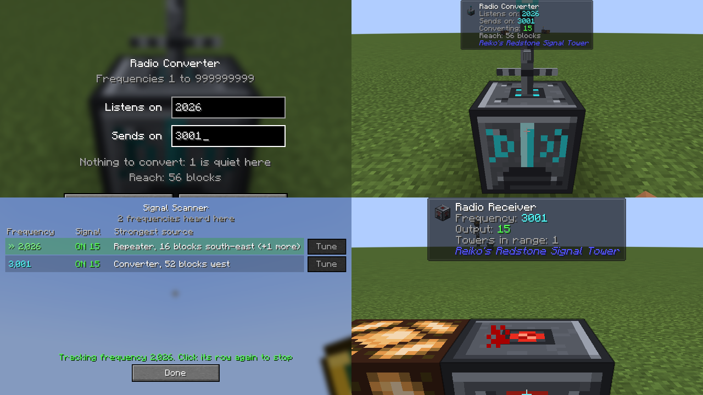

### Code Keypad

A **Code Keypad** is a thin panel you put on a wall, floor or ceiling. Type its code and it sends a pulse on its frequency, from where it is, like a remote pressed there (towers in its reach relay it). For as long as the pulse lasts, its display lights green and, like a button, it powers the block it's on, so an iron door next to that block opens without any radio at all.

- **Setting it up:** place it, tune it with the Frequency Tuner like any radio block (or place one that already has a frequency), and right-click it. You placed it, so you own it: type 4 to 8 digits and click **Set code** ("New code saved (4 digits)"). **Pulse** sets how long the pulse lasts, from 0.1 to 10 seconds (sneak-click for shorter).
- **Using it:** anyone right-clicks it (empty hand or holding anything but the tuner) and types the code with the keys or the keyboard, then **OK** or Enter. The right code closes the screen: "Code accepted: 1s pulse on 2026 (Front Gate) | Heard by 3 receivers".
- **Wrong codes:** "Wrong code (1 of 3 tries)". Three in a row lock that player out for 30 seconds ("LOCKED"), and you're told in chat: "Radio alert: Alex typed the wrong code 3 times on your Code Keypad at 406, -59, -9, on 2026 (Front Gate): locked out for 30 seconds". If you're offline, it's in the summary you get when you log in. Your own mistakes don't alert you.
- **The code stays secret:** it's never sent to anyone's game, the display only shows stars, and the message after setting it only says how many digits. Breaking the keypad keeps its frequency on the item but forgets the code and the owner: whoever places it next sets a new one.
- **Only the owner changes it:** only you (or a server operator) can set the code and pulse, or re-tune it ("This Code Keypad is Dev's: only they can tune it").
- **Private frequencies:** like a transmitter, it only sends on someone else's private frequency if you're a member. Otherwise it stays silent, you're told when you place it, and the frequency's owner gets an intruder alert. Anyone who knows the code can use your keypad, though, even if they aren't on the frequency themselves: that's what the code is for.
- **The log** lists its turn-ons as **Code Keypad**, with who typed the code and where the keypad is (click the row for a beam over it).
- **Jade** shows its frequency, owner, whether a code is set (never the code itself), "Waiting for the code" or "Code accepted: on", and its reach.

### Reach preview ring

Hold a Frequency Tuner (either hand) and look at a Radio Transmitter, Repeater, Converter or Code Keypad, or at a mast under one, from up to 128 blocks away. A dotted ring appears on the ground where its reach ends, in the color of its light (red, amber, teal, or green for a keypad), and two lines above your hotbar say what it is and where you stand: "Reach ring: Radio Transmitter on 2026 (Front Gate), 56 blocks" and "You're inside: 54 blocks to the edge" (or "You're 7 blocks outside").

- The ring stays on that tower while you keep holding the tuner, so you can walk out to the edge to see where to put the next repeater or receiver. Look at another tower to move it; put the tuner away to clear it.
- The dots follow the ground, and far ones are drawn bigger so the ring still shows from a hilltop. Only you see it, and only the part within your render distance.
- The reach comes from the server, so it's always the real one (the dimension's sea level and the server config).

### Reach

Reach is measured horizontally from the transmitter (or repeater), so a receiver works at any height inside that circle.

```
reach = 32 + 8 × (blocks above sea level)
```

| Transmitter at | Height above sea level | Reach |
|---|---|---|
| Y=63 or lower (Overworld) | 0 | 32 blocks |
| Y=80 | 17 | 168 blocks |
| Y=100 | 37 | 328 blocks |
| Y=150 | 87 | 728 blocks |
| Y=319 (build limit) | 256 | 2,080 blocks |

Sea level is the dimension's own: Y=63 in the Overworld, Y=32 in the Nether, Y=−63 in a default superflat world. Building on a mountain counts too.

All three numbers (base reach, reach per block of height, and an optional maximum) are in the server config: `<world>/serverconfig/reikos_signal_tower-server.toml`, or Mods → Reiko's Redstone Signal Tower → Config. The same file has `towersRelayRemotes` (on by default), which lets transmitters and repeaters relay remote presses on any frequency, and `privateFrequenciesPerPlayer` (32 by default; 0 means nobody can make a frequency private).

### Recipes

```
Radio Transmitter       Radio Receiver          Radio Mast (x6)       Frequency Tuner
  .  L  .                 .  L  .                 B  .  B               .  T  .
  I  E  I                 I  E  I                 B  I  B               I  G  I
  I  T  I                 I  P  I                 B  .  B               I  R  I

L = Lightning Rod   E = Ender Pearl   T = Redstone Torch   P = Redstone Repeater
I = Iron Ingot      B = Iron Bars     G = Glass Pane       R = Redstone Dust
```

**Radio Repeater:** a Radio Receiver and a Radio Transmitter, in any arrangement in the crafting grid.

**Radio Converter:** a Radio Repeater and a Redstone Comparator, in any arrangement in the crafting grid.

**Radio Toggle Receiver:** a Radio Receiver and a Lever, in any arrangement in the crafting grid. Put a toggle receiver in the grid on its own to get the Radio Receiver back.

**Compact Radio Receiver:** put one Radio Receiver in the crafting grid to get a Compact Radio Receiver. It works the other way too, so you can switch back any time.

**Remote Control:**

```
  .  T  .        T = Redstone Torch   B = Stone Button
  I  B  I        I = Iron Ingot       E = Ender Pearl
  I  E  I
```

**Multi-Button Remote:** a Remote Control plus 3 Stone Buttons, in any arrangement in the crafting grid.

**Code Keypad:** a Remote Control, an Iron Ingot and a Stone Button, in any arrangement in the crafting grid.

**Radio Pager:** a Compact Radio Receiver, a Note Block and an Iron Ingot, in any arrangement in the crafting grid.

**Signal Scanner:** a Radio Receiver, a Compass and an Iron Ingot, in any arrangement in the crafting grid.

**Wall Redstone:** put one Redstone Dust in the crafting grid to get one Wall Redstone, and back again the same way. To place it, right-click the side of any solid block.

## Building and running

You need **Java 21**. If Gradle can't find it, it downloads one automatically.

```bash
./gradlew build              # builds build/libs/reikos_signal_tower-<version>.jar
./gradlew runClient          # starts Minecraft with the mod
./gradlew runServer          # starts a dedicated server with the mod
./gradlew runGameTestServer  # runs the automated in-game tests, then exits
```

The dev runs include [Jade](https://modrinth.com/mod/jade) for testing the optional tooltip plugin (it isn't bundled in the jar). Add `-PnoJade` to any run to leave it out, for example `./gradlew runGameTestServer -PnoJade`.

On Windows use `gradlew.bat` instead of `./gradlew`.

**IntelliJ IDEA:** File → Open → pick this folder's `build.gradle` → Open as Project. Wait for the Gradle sync to finish, then use the generated run configurations (Client, Server, GameTestServer).

To play it in your own instance, copy the jar from `build/libs/` into the instance's `mods` folder. Every push to `main` is also built by GitHub Actions. The jar is attached to each run under **Actions → Build → Artifacts**.

## Project layout

```
src/main/java/com/reiko/signaltower/
  SignalTower.java                       mod entry point: registration, creative tabs, packets
  Config.java                            server config (reach settings, tower relay switch, private frequency limit)
  registry/ModRegistry.java              blocks, items, block entities, the frequency data component
  block/RadioBlock.java                  shared transmitter/receiver code: status readout, tooltips
  block/RadioTransmitterBlock.java       reads input, broadcasts
  block/RadioReceiverBlock.java          redstone output
  block/RadioToggleReceiverBlock.java    receiver that flips on and off with each turn-on
  block/RadioRepeaterBlock.java          picks up its frequency and broadcasts it again
  block/RadioConverterBlock.java         a repeater that sends on another frequency; opens its screen
  block/CompactRadioReceiverBlock.java   button-sized receiver that attaches to a face
  block/RadioMastBlock.java              tower segment, carries signal up to the transmitter
  block/WallRedstoneBlock.java           redstone dust for walls
  blockentity/RadioBlockEntity.java      stores the frequency (kept through break/re-place) and who last tuned or placed it
  blockentity/RadioTransmitterBlockEntity.java
  blockentity/RadioReceiverBlockEntity.java
  blockentity/RadioRepeaterBlockEntity.java  repeater and converter: checks in with the network, drives the light, a converter's output frequency
  item/TunerPresets.java                 5 favorite frequencies (data component)
  item/RadioFavorites.java               sneak + scroll and favorites for the tuner, remote and pager
  item/FrequencyTunerItem.java           tune, copy, open the frequency screen
  item/RemoteControlItem.java            handheld transmitter: pulse or toggle
  item/MultiRemoteItem.java              4-button remote
  item/PagerItem.java                    pocket receiver that beeps when its frequency turns on
  item/SignalScannerItem.java            handheld that lists every frequency heard where you stand, and tracks one
  item/ScannerTarget.java                the transmitter a scanner is tracking (data component), arrow angle
  client/ScannerHud.java                 the tracking arrow at the top of the screen
  item/RemoteButtons.java                the 4 buttons' settings (data component), colors
  item/PulseLength.java                  pulse length presets, limits and labels
  item/RemoteLight.java                  the remotes' green/red status light after a press
  network/RemoteScanRequestPayload.java  remote screen -> server: who's listening? (locator)
  network/RemoteScanResultPayload.java   server -> remote screen: the answer
  client/LocatorText.java                turns a locator answer into a line of text
  network/ConfigureMultiRemotePayload.java  keypad -> server (save, and optionally press)
  network/SelectRemoteButtonPayload.java sneak + scroll -> server
  network/ConfigureRadioItemPayload.java frequency screen -> server packet
  radio/SignalNetwork.java               per-dimension list of transmitters, repeaters and remote signals (with relay coverage), saved with the world
  radio/RadioHelper.java                 height, reach, mast-column logic
  radio/Frequency.java                   frequency range (1 to 999,999,999)
  radio/FrequencyNames.java              frequency names, saved with the world (and the client's synced copy)
  network/SetFrequencyNamePayload.java, FrequencyNamePayload.java, FrequencyNamesPayload.java  naming, and keeping clients in sync
  radio/FrequencyClaims.java             private frequencies: owners and friends, saved with the world (and the client's synced copy)
  network/SetFrequencyPrivacyPayload.java, FrequencyClaimPayload.java, FrequencyClaimsPayload.java  the Private button and Friends box, and keeping clients in sync
  client/GroupsScreen.java               the friend groups screen
  network/EditGroupPayload.java, GroupsPayload.java  saving a friend group, and sending a player their groups
  compat/RadioInfo.java                  what Jade shows for each radio block (works without Jade)
  compat/jade/SignalTowerJadePlugin.java the Jade plugin (only loaded by Jade)
  client/FrequencyScreen.java            the frequency (and remote mode) screen
  client/DirectoryScreen.java            the frequency directory
  network/DirectoryRequestPayload.java, DirectoryResultPayload.java  the directory asking the server what's on
  client/MultiRemoteScreen.java          the Multi-Button Remote keypad
  client/ConverterScreen.java            the Radio Converter's two frequencies
  block/CodeKeypadBlock.java             the Code Keypad: attaches like a button, opens its screen, powers the block it's on
  blockentity/CodeKeypadBlockEntity.java its owner, code (server only), pulse length, lockouts, and sending the pulse
  client/KeypadScreen.java               the keypad's screen
  network/OpenKeypadScreenPayload.java, KeypadEnterPayload.java, KeypadConfigurePayload.java, KeypadResultPayload.java  keypad screen <-> server
  client/ReachRing.java, ReachRingShape.java  the reach preview ring and its two lines above the hotbar
  network/ReachPreviewRequestPayload.java, ReachPreviewPayload.java  asking the server how far a tower reaches
  network/OpenConverterScreenPayload.java, ConfigureConverterPayload.java  converter screen <-> server
  client/ClientHooks.java, SignalTowerClient.java   client-only setup
  gametest/SignalTowerGameTests.java     automated tests
src/main/resources/
  assets/reikos_signal_tower/            blockstates, models, textures, en_us.json
  data/reikos_signal_tower/              recipes, loot tables, recipe-book unlocks, test structure
tools/
  make_textures.py                       draws all textures (needs Pillow)
  make_data.py                           writes models, blockstates, lang, recipes, loot tables
docs/
  DESIGN.md                              how it works under the hood, ideas for later
```

The `tools/` scripts are how the textures and JSON files were generated. You can keep using them, or paint and edit the files directly. Re-running a script overwrites what it writes.

## Automated tests

`./gradlew runGameTestServer` boots a server and checks that:

1. a signal crosses the gap, turns off with the input, and stops when the transmitter is broken;
2. signal strength is kept (14 in, 14 out);
3. different frequencies don't hear each other, and re-tuning a receiver links it;
4. a receiver just out of reach goes live once the transmitter is raised 4 blocks on masts;
5. masts carry the signal up from any point in the column, and a gap in the column cuts it;
6. the tuner tunes a block on right-click and copies a block's frequency on sneak + right-click;
7. a broken transmitter drops an item that keeps its frequency;
8. a compact receiver on a wall powers that wall block, lighting a lamp on the far side;
9. removing the wall knocks the compact receiver off, and its dropped item keeps its frequency;
10. Wall Redstone climbing a pillar goes 15, 14, 13 … and lights a lamp at the top, then turns fully off;
11. Wall Redstone and normal dust power each other, and both turn fully off when the source is removed (no stuck-on loops);
12. Wall Redstone powers the block it's on, lighting a lamp behind the wall;
13. removing the wall knocks Wall Redstone off and drops it;
14. a Remote Control pulse turns a receiver on for about a second, then off;
15. a Remote Control in toggle mode stays on until pressed again;
16. a Remote Control can't reach a receiver beyond its reach;
17. sneak + right-clicking a transmitter copies its frequency into the remote;
18. a Multi-Button Remote's buttons each drive their own frequency and mode;
19. sneak + right-click copies a frequency into the selected button only;
20. remote button settings are always tidied up (4 buttons, valid selection and frequencies);
21. a Remote Control set to a 5-second pulse is still on after 3 seconds, then turns off;
22. a Multi-Button Remote button set to 0.25 seconds turns off well before a normal 1-second pulse would;
23. pulse length presets step and wrap correctly and stay within 0.1–10 seconds;
24. a remote's light goes green when a receiver in range heard the press;
25. it goes red when receivers are only out of range or on another frequency;
26. a re-tuned receiver stops counting for its old frequency;
27. a broken receiver stops counting straight away;
28. button names lose colour codes, control characters and extra spaces, and are cut to 24 characters;
29. named buttons are labelled with their name, unnamed ones as "Button N";
30. names survive saving and network sync, and remotes saved before names existed still load;
31. copying a frequency into a named button keeps its name;
32. the locator counts receivers in range and points at the nearest one;
33. with nothing in range, it says where the nearest one just out of range is;
34. receivers more than twice the reach away stay hidden;
35. the eight compass directions come out right;
36. a transmitter on a tower next to the player relays a remote press (on another frequency, unpowered) to a receiver beyond the player's own reach, and the light and message count it;
37. a tower farther away than the player's reach doesn't relay;
38. with relaying switched off, only the player's own reach counts;
39. a toggle switched on through a tower turns off when the tower is broken;
40. a toggle's tower areas survive saving and loading, and the old save keys are still written for older versions;
41. toggles saved by version 0.10.0 still load;
42. the locator and the light count receivers that only a tower reaches;
43. buttons default to red, lime, blue and yellow, and clicking goes through all 16 dye colors both ways;
44. button colors survive saving and network sync, and remotes saved before colors existed load with the defaults;
45. the item's button layers are tinted with each button's color, labels use it, and every color stays readable on a tooltip;
46. a pager in the inventory alerts once when a transmitter in reach turns on (frequency and strength in the message), starts beeping, goes quiet, and alerts again next time;
47. a pager hears a Remote Control press made near its owner;
48. a powered transmitter out of reach leaves the pager quiet;
49. a renamed pager uses its name in the alert, and a silenced one shows the message without beeping;
50. pagers count toward a remote's "Heard by" only when in range and on that frequency, and re-tuning re-arms the alert;
51. the scanner lists what a receiver here would hear (silent transmitters too), strongest first, with distance and direction, and leaves out transmitters whose reach doesn't cover you;
52. with several transmitters on one frequency, it points to the strongest, then the nearest, and counts them all;
53. remote signals show as "remote" with no distance or direction, and remotes that don't cover you aren't listed;
54. a real placed transmitter shows up in a scan of the world;
55. the Tune buttons work on the tuner, both remotes and the pager, and change only the Multi-Button Remote's selected button's frequency;
56. tuner favorites always have 5 slots, empty bad numbers, cap huge ones, and can be saved and cleared;
57. jumping between favorites goes in slot order, skips empty slots and wraps around, both ways;
58. favorites survive saving and network sync, and a tuner without any has no extra data;
59. sneak + scroll steps by 1 and stops at 1 and 999,999,999; with Ctrl it jumps between favorites, and says so when there are none;
60. the Remote Control and pager scroll and jump between favorites too (the remote keeps its mode and pulse length, the pager re-arms its alert), and the Multi-Button Remote and scanner don't;
61. the remote's, pager's and tuner's tooltips list their favorites right under the frequency and explain scrolling;
62. a pager posts its alert in chat (day and time, then the alert) as well as above the hotbar, and one with its chat log off only shows it above the hotbar;
63. the chat line's day and time come from the world's day time, with days starting at midnight;
64. the chat log is on by default, can be switched off and on, and the tooltip says which;
65. the scanner tracks the same transmitter its row points to (strongest, then nearest), and can't track one whose reach doesn't cover you;
66. tracking a placed transmitter stores where it is; re-tuning or breaking it loses the track; remote-only and empty frequencies can't be tracked; stopping clears it;
67. the target survives saving and sync, and the arrow points ahead, left, right or behind correctly for each facing;
68. the network remembers each turn-on (a transmitter going from off to on, a remote pulse, a toggle switched on), not staying on, strength changes or switching off, and keeps the last 32 per frequency;
69. the remembered turn-ons are saved with the world;
70. at login, each pager reports how often its frequency turned on where the player is while they were away ("once", "N times"), one line says so if nothing happened, and singleplayer stays quiet;
71. logging out stamps every pager in the inventory, off-hand included, and nothing else;
72. a repeater in a transmitter's reach passes the signal on at the same strength, a second one carries it further, other frequencies aren't repeated, and switching off or removing a repeater breaks the chain;
73. two repeaters in each other's reach stay on only while a real source (transmitter, remote pulse or toggle) feeds them, and each repeats the strongest signal it gets;
74. repeaters are saved with the world and keep repeating after loading;
75. a remote press counts the receivers repeaters carry it to (without adding a relaying repeater twice), and the message wording names the repeaters;
76. turn-ons are remembered over the repeaters they reached, for the pager catch-up;
77. the scanner names a repeater as the source with its distance and direction, can track it, lists a quiet one as off, and prefers a transmitter in a tie;
78. a placed repeater checks in, lights up while repeating, reaches a receiver the transmitter can't, relays remote presses as a tower, stops when re-tuned or broken, and drops with its frequency;
79. a remote press with no towers relaying is carried by a repeater on its frequency to a far receiver, and the message and light count it;
80. the Jade info: the server reads each transmitter's, receiver's and repeater's frequency, signal, reach and towers in range, and what's on top of a mast column; the lines come out in the right order; without server data only what the block state shows is listed;
81. quiet blocks say "Sending: nothing", "Output: off" and "Nothing to repeat", the compact receiver matches the full one, and other blocks get nothing;
82. a converter sends what it hears on another frequency at the same strength, isn't heard on the one it listens on, bumps its output frequency's revision when its input changes, and turns back into a repeater when set to the same frequency;
83. two converters feeding each other (A to B and back) only stay on while a real source feeds them, and a repeater carries the converted frequency further;
84. a remote press is carried across a converter: receivers on the other frequency count, and the message names it;
85. a turn-on carried across a converter is remembered on the converted frequency too;
86. the scanner lists a converter under the frequency it sends on, as "Converter", and can track it;
87. converters are saved with their output frequency, and repeaters saved by 0.20.0 still load as repeaters;
88. a placed converter is set from its screen's packet (only from within reach), lights a receiver on its output frequency, shows in Jade (and on the mast under it), and keeps both frequencies on the dropped item and when placed again;
89. a toggle receiver flips on each time the transmitter turns on and ignores it turning off; its state is saved and loaded back, and Jade shows it;
90. a weak signal (14) switches it fully on (15);
91. remote pulses switch it on with one press and off with the next, and the press counts it as heard;
92. a frequency that's already on when it's placed, or when it's re-tuned to it, isn't a turn-on: it waits for the next one;
93. frequency names are tidied (spaces, formatting codes, length), removed by an empty name, capped at 4,096, saved, and survive the network;
94. the client's copy of the names is filled by the full list, changed one at a time and cleared on leaving;
95. naming a frequency only works with a tuner in hand, and the name then shows in the remote's press message, the pager's alert, Jade and the tuner's message; a frequency without a name shows just its number;
96. private frequency claims allow only the owner and friends, cap the friends at 16 (leaving the owner out, keeping their order), and survive saving, both network packets and the client's copy; the Friends box splits names on commas and spaces without repeats;
97. on a private frequency, a stranger's transmitter, repeater and converter stay quiet (receivers and the scanner don't hear them, their turn-ons aren't remembered, a press isn't carried through them), while the owner's, a friend's and an old untracked one work; who tuned them is saved; taking a friend off silences theirs at once, and making it public brings everyone back;
98. a stranger's remote press on a private frequency is refused (with a red light and the owner's name) and can't switch it on or off, while the owner's and a friend's presses work;
99. the Private button only works with a tuner in hand; only the owner changes a private frequency, an operator can make it public; unknown names are reported, offline friends are kept by name, the per-player limit is enforced, and a frequency other players' blocks send on can't be claimed; only members rename it;
100. a stranger can't tune a transmitter or converter onto a private frequency (a receiver is fine), a block they place with it stays silent and says so (readout and Jade), and whoever tunes or places a block becomes its tuner, saved with it;
101. the directory's answer survives the network, and each entry knows whether it's hidden and whether it's on;
102. "strongest anywhere" counts transmitters far from everything, leaves out silenced ones, and counts converters sending on the frequency and remote toggles;
103. the directory answers only players holding a radio item, lists named and private frequencies in order, hides someone else's private frequency except for what's heard where the player stands, and shows a player's own, a public one and one they're a friend on;
104. friend groups leave out their owner and cap their members; a claim uses its owner's groups by name (ignoring case, unknown ones left out) and lets their members send; renaming carries the frequencies along, changing members or deleting the group changes who can send; all of it survives saving and the network; the Friends box tells "#groups" from names;
105. a group member's transmitter broadcasts on a frequency using the group, goes silent as soon as they're taken out, and comes back when they're put back;
106. the Groups screen's packet needs a tuner in hand and a name that isn't already one of the player's groups; unknown members are reported and offline ones kept by name; renaming carries a frequency along; the per-player limit; deleting; and the Friends box takes "#group" and reports unknown ones;
107. the directory answers a player with nothing in hand who opened it from a converter's screen within reach, but not for a converter out of reach or a block that isn't one; a Multi-Button Remote in hand counts; the request survives the network;
108. an encrypted claim is heard only by its owner, friends and group members (and blocks with no recorded tuner); it's saved (older saves load unencrypted), survives the network along with the tuner's packet, and stays encrypted when a group it uses is renamed or deleted;
109. on an encrypted frequency, a non-member's receiver hears nothing (no signal, no towers), their scanner doesn't list it, their converter neither passes it on nor carries presses, and their receivers aren't counted by remotes or the locator; members' and old blocks hear it; made just private, everyone hears it again;
110. real blocks: a stranger's receiver and toggle receiver stay off and say why (the tuner's message, the readout, Jade), the friend's and an old one light up; just private, the stranger's lights up, and becoming able to hear isn't a turn-on for the toggle receiver;
111. a non-member's pager doesn't alert, isn't counted for "Heard by" and reports nothing in the catch-up; their scanner can't track it and drops a target on it; their directory shows only "Encrypted"; the friend's do all of that;
112. the tuner's packet encrypts a new claim, decrypts and re-encrypts it, says so, changes nothing when asked for what it already is, refuses anyone but the owner, and lets an operator only make it public;
113. notes are tidied (spaces trimmed, formatting codes dropped, cut to 64 characters), an empty one removes the note, frequencies are clamped, a world keeps at most 4,096 (existing ones can still change), they're saved, the three note packets survive the network, and the client's copy (with its tooltip line) is kept up to date and cleared on leaving;
114. the Note screen's packet needs a tuner in hand, sets and removes a note and says so, changes nothing when nothing changed, and on a private frequency refuses non-members but lets a friend and an operator change it;
115. Jade's data carries the note and shows it right under the frequency line (under both lines for a converter, none without a note), and the directory lists frequencies that only have a note;
116. the audit of an encrypted frequency lists the owner's transmitter (sending 15), an old one with no recorded tuner, a friend's receiver and the owner's toggle receiver and listening converter with their positions; a stranger's silent transmitter, two deaf receivers (one row, counted) and deaf converter without positions; the owner's rows first; nothing for a public frequency; the row limit;
117. only the owner or an operator may audit a frequency (not a friend, not a public frequency), and the request and answer survive the network;
118. a note kept to members is saved (older saves load open), saving without the switch or removing the note drops it, releasing keeps the note, the three note packets carry the switch, and the client's copy (with "(members only)" on the tooltip line) follows each change;
119. a members-only note reaches the owner, a friend, a group member and an operator but not a stranger (nor nobody): the stranger's one-note packet is empty and their join list leaves it out; made public, everyone sees it, and claiming it again doesn't hide it;
120. the Note screen's packet keeps a note to members on a private frequency and says so, counts a change of only the switch, ignores the switch on a public frequency, and Jade's data leaves the note out for a stranger and marks it for the owner;
121. audit beams turn on for a minute (in their own dimension only) and off when clicked again, burn down tick by tick and go when spent, a ninth drops the one with the least time left, and leaving the world clears them;
122. handing a frequency over: only its owner may (not a friend or an operator), only to one of its members (a group member counts, the name ignoring case), not to someone at their limit nor when it has more members than 16 friends; the new owner gets it with everyone else as single friends (the old owner first), still encrypted, with its note; the old owner's blocks still send and a stranger's don't; a public one has nothing to hand over; the packet survives the network;
123. the frequency log lists the owner's transmitter (with its position), one with no recorded tuner (with its position), a friend's remote pulse and a stranger's toggle (named, no position), newest first; a silenced stranger's transmitter isn't a turn-on; someone no longer on it is named but not located; a converter's output frequency shows them carried over; only the owner and operators get it, not for a public frequency; causes are saved and old saves load without them; the answer survives the network;
124. a guest can send on a private frequency and hear it (encrypted) until their pass runs out, then drops off and their blocks go silent; never the owner, a friend or a ninth guest (a renewal still works when full); the owner's packet renews and removes guests and refuses an offline name, a wrong length, a non-owner and a public frequency; editing the friends or handing it over keeps the guests (not one who became a friend); guests are saved and sent to clients;
125. intruder alerts: a stranger's refused remote press (the real remote code), a transmitter they place that stays silent (the real placement) and a tune attempt are kept for an owner who's away, at most once a minute each; friends and public frequencies don't alert; at login the owner gets how many and the last five, then they're forgotten; older ones are only counted; kept alerts survive saving.
126. the reach preview: the server answers a player holding a tuner (either hand) with the reach of a transmitter, repeater, converter (on the frequency it sends on) or Code Keypad; a receiver, another block, no tuner or more than 160 blocks away gets "nothing to show"; the answer survives the network;
127. the ring's shape: "inside" follows the network's own rule for every offset and reach, the distance to the edge counts down to 0 and goes negative outside, the dots sit 1.5 blocks apart half a block outside the reach, and huge rings are capped;
128. the Code Keypad: only its owner sets a code (4 to 8 digits; an operator may too) and the message doesn't repeat it; a remote in hand still opens it and only the owner re-tunes it; three wrong codes lock that player (not others) out for 30 seconds, even for the right code, and alert the owner (kept with where the keypad is, surviving saving), but not for the owner's own mistakes; afterwards the right code sends the pulse (heard nearby, recorded as the keypad with who typed it), lights it and powers the block it's on until the pulse ends; the code is saved, but only the frequency goes on the item, and the screen's packet never carries it;
129. a keypad placed on someone else's private frequency says it's silent, alerts that frequency's owner and sends nothing for the right code (Jade says silent); a member's keypad shows in Jade (owner, no code yet, waiting, reach, never the code) and in the frequency log (the keypad's position, typed by a stranger who knew the code), and the log's new kind survives the network.

All 129 also pass with `-PnoJade`, so the mod runs the same without Jade.

## License

All rights reserved. To open-source it, add a `LICENSE` file and update `mod_license` in `gradle.properties`.
